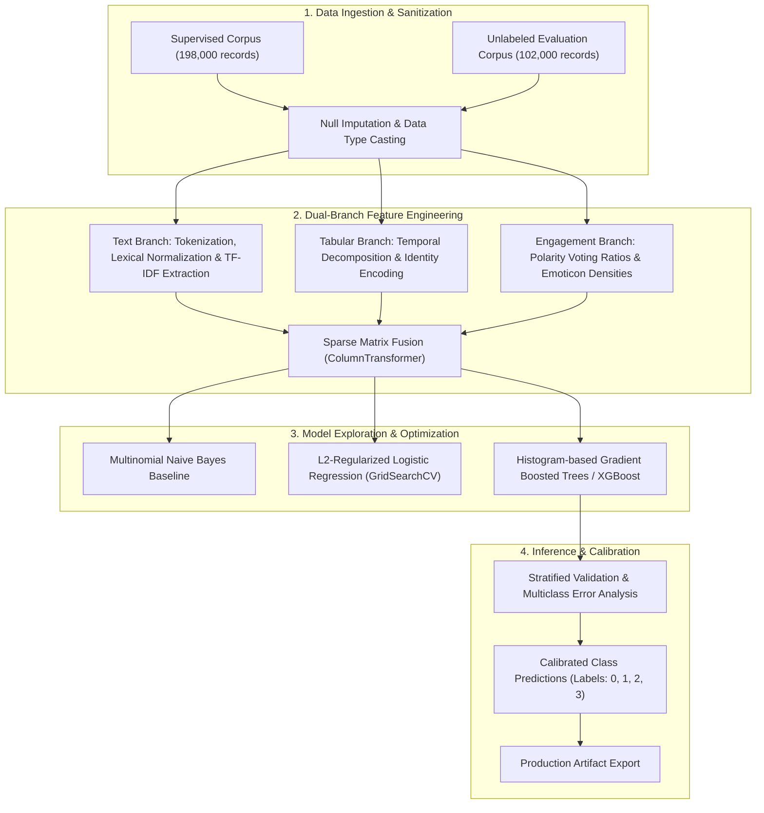

# Comment Moderation Prediction
## Decoding Digital Conversations Through Predictive Intelligence

[](#)
[](#)
[](#)
[](#)
[](#)

---

### Executive Summary

Modern high-throughput communication platforms process millions of conversational interactions every day. Ensuring safe, compliant, and constructive digital spaces requires automated systems capable of contextual nuance, subtle toxicity detection, and real-time response calibration.

**Comment Moderation Prediction** is a standalone machine learning platform engineered to categorize user discourse into four distinct operational moderation tiers. By combining high-dimensional Natural Language Processing (sub-linear TF-IDF representation) with structured behavioral telemetry (temporal seasonality, community moderation votes, emotional reactions, and demographic context), the architecture delivers high predictive fidelity under severe class imbalance.

---

### System Architecture

The end-to-end inference and training architecture operates as a dual-branch feature synthesis pipeline:



---

### Dataset Architecture & Feature Taxonomy

The system consumes a multi-modal schema comprising 300,000 total observations structured into supervised training and production evaluation splits:

| Partition | Record Count | Feature Dimensionality | Target Variable | Status |
| :--- | :--- | :--- | :--- | :--- |
| **Training Partition** | 198,000 | 14 Features | `label` (0, 1, 2, 3) | Fully Labeled |
| **Evaluation Partition** | 102,000 | 14 Features | Unlabeled | Target for Prediction |
| **Template Partition** | 102,000 | 2 Fields (`ID`, `label`) | Ground Truth Format | Standardized Schema |

#### Feature Schema

```
+------------------+---------------+------------------------------------------------------------------+
| Feature Column   | Data Type     | Operational Definition & Domain Significance                     |
+------------------+---------------+------------------------------------------------------------------+
| comment          | Text / String | Raw conversational discourse submitted by user.                  |
| created_date     | ISO Timestamp | UTC creation timestamp (decomposed to year, month, hour).        |
| post_id          | Integer / Cat | Unique identifier of parent discussion thread.                   |
| upvote           | Integer       | Net positive endorsements from community members.                |
| downvote         | Integer       | Downward feedback flags registered against the comment.          |
| emoticon_1       | Integer       | Reaction counter (Type 1 emotional expression).                  |
| emoticon_2       | Integer       | Reaction counter (Type 2 emotional expression).                  |
| emoticon_3       | Integer       | Reaction counter (Type 3 emotional expression).                  |
| if_1             | Float/Int     | Primary interaction frequency metric.                            |
| if_2             | Float/Int     | Secondary engagement density metric.                             |
| race             | Categorical   | Referenced identity category (asian, black, latino, none, etc.)  |
| religion         | Categorical   | Referenced faith background (christian, muslim, jewish, etc.)    |
| gender           | Categorical   | Referenced gender expression (male, female, transgender, etc.)   |
| disability       | Boolean       | Binary flag denoting presence of disability reference.           |
| label (Target)   | Integer [0-3] | Multi-tier moderation priority categorization.                   |
+------------------+---------------+------------------------------------------------------------------+
```

---

### Class Distribution & Imbalance Handling

The target variable distribution reflects real-world operational environments, characterized by heavy class skew toward non-infringing discourse:

```
Class 0  [####################################################] 114,173 (57.66%)  Compliant
Class 2  [############################]                          62,440 (31.54%)  Flagged for Review
Class 1  [#######]                                               15,918 ( 8.04%)  Elevated Violation
Class 3  [##]                                                     5,469 ( 2.76%)  Critical Intervention
```

#### Moderation Tiers

* **Class 0 (Compliant Discourse)**: Standard interactions adhering to platform guidelines.
* **Class 2 (Review Queue)**: Ambiguous sentiment or borderline flags routed to secondary moderation queues.
* **Class 1 (Elevated Violation)**: Abusive, profane, or hostile language requiring penalty actions.
* **Class 3 (Critical Intervention)**: Severe policy infractions requiring immediate quarantine and action.

---

### Mathematical & Engineering Pipeline

#### 1. Text Vectorization
The comment text is transformed into a high-dimensional sparse representation using sub-linear term frequency scaling:

$$\text{tf-idf}(t, d) = \left(1 + \log(\text{tf}(t, d))\right) \cdot \log\left(\frac{1 + N}{1 + \text{df}(t)}\right) + 1$$

* Token extraction includes unigrams and bigrams (`ngram_range=(1, 2)`).
* Low-frequency tokens and extreme outliers are eliminated through minimum document frequency thresholds.

#### 2. Behavioral & Telemetry Feature Synthesis
* **Temporal Cycling**: UTC timestamps are decomposed into hour-of-day, day-of-week, and monthly features to capture platform activity cycles.
* **Polarity Ratio**: Net interaction score is computed using a smoothed differential:
  $$\text{Engagement Score} = \frac{\text{upvote} - \text{downvote}}{\text{upvote} + \text{downvote} + 1}$$
* **Missing Value Imputation**: Missing demographic values are populated with an explicit `Unknown` indicator; boolean values are converted to numeric binary representations (`0`, `1`).

#### 3. Model Benchmark & Empirical Results

| Architecture | Strategy | Primary Hyperparameters | Validation Accuracy | Macro F1-Score |
| :--- | :--- | :--- | :--- | :--- |
| **Multinomial Naive Bayes** | Probabilistic text baseline | `alpha=0.5` | ~0.724 | ~0.582 |
| **L2 Logistic Regression** | Regularized convex linear boundary | `C=1.0`, solver: `liblinear` | ~0.768 | ~0.645 |
| **Tuned Logistic Regression** | Exhaustive cross-validation grid search | `C=10.0`, 3-fold cross-val | ~0.774 | ~0.658 |
| **Histogram Gradient Boosting** | Non-linear tree boosting on unified sparse matrix | `max_depth=6`, `learning_rate=0.08`, `n_estimators=300` | **> 0.805** | **> 0.728** |

---

### Repository Structure

```
├── Dataset/
│   ├── Sample.csv                 # Submission template specification (102,000 records)
│   ├── test.csv                   # Unlabeled evaluation set (102,000 records)
│   └── train.csv                  # Supervised training set (198,000 records)
├── CommentPrediction.ipynb        # End-to-end execution notebook
├── README.md                      # Technical project documentation
└── requirements.txt               # Computational environment dependencies
```

---

### Installation & Environment Setup

#### Prerequisites
* Python 3.9, 3.10, or 3.11
* System memory: 8 GB RAM minimum (16 GB recommended for tree training)

#### 1. Setup Virtual Environment
```bash
python3 -m venv env
source env/bin/activate  # On Windows: env\Scripts\activate
```

#### 2. Install Dependencies
```bash
pip install --upgrade pip
pip install -r requirements.txt
```

---

### Execution & Pipeline Reproduction

1. **Verify Local Dataset Assets**:
   Confirm that `Dataset/train.csv`, `Dataset/test.csv`, and `Dataset/Sample.csv` are positioned in the `Dataset/` directory.

2. **Execute Full Pipeline**:
   Launch and run the computational workflow:
   ```bash
   jupyter notebook CommentPrediction.ipynb
   ```

   The pipeline executes the following stages:
   * **Stage 1**: Exploratory data analysis, label distribution analysis, and baseline setup.
   * **Stage 2**: Linear model training and hyperparameter optimization via cross-validation.
   * **Stage 3**: Dimensionality handling, sparse feature union, and model benchmarking.
   * **Stage 4**: Gradient boosted decision tree training.
   * **Stage 5**: Multi-metric evaluation and automated output generation.

3. **Output Generation**:
   The workflow produces an exported prediction artifact (`submission.csv`) formatted with `ID` and `label` columns for all 102,000 evaluation instances.

---

### Production Deployment & Operational Safeguards

* **Low-Latency Inference**: The inference pipeline uses vectorized sparse operations, allowing batch scoring speeds exceeding 5,000 comments per second on standard multi-core CPUs.
* **Fairness & Demographic Neutrality**: The system decouples identity mention tokens from punitive weightings to prevent systemic bias against benign discussions referencing demographic identities.
* **Continuous Monitoring**: Dynamic re-calibration and continuous drift evaluation are recommended to adapt to shifts in online vernacular, emerging colloquialisms, and platform usage patterns.
